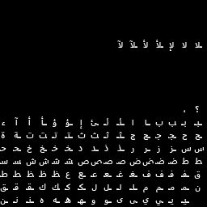
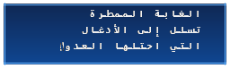
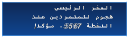
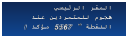

# Mega Man X4 — Arabic Localization (تعريب ميجا مان إكس 4)

تعريب عربي متكامل وهندسة عكسية للنسخة الأصلية من لعبة **Mega Man X4** لجهاز **PlayStation 1 (PS1 — SLUS-00561)** — *ليست نسخة الـ Recomp* — يتضمن ترجمة عربية احترافية كاملة لحملتي **X** و **Zero** (**104** رسالة)، خط عربي متصل بدقة **16×16** مع الحفاظ التام على الخط الإنجليزي للقوائم (`0x40..0x8D`)، محرك عرض عربي أصيل من اليمين إلى اليسار (**Native MIPS RTL**) مدمج داخل `SLUS_005.61`، ورقعة **BPS1** قانونية قياسية (**44.4 KB** فقط) متحقّق منها بايتاً ببايت.

Comprehensive Arabic fan translation, 16×16 cursive Arabic font atlas (preserving the original English font range `0x40..0x8D` for menus/HUD), native MIPS RTL dialogue engine patch in `SLUS_005.61`, full localization & verification tooling, and a spec-compliant legal **BPS1** delta patch (**44.4 KB**) for the original PlayStation 1 release of *Mega Man X4* (USA, `SLUS-00561`).

---

## 📸 معاينات الخط والحوار العربي / Font Atlas & RTL Dialogue Previews

| أطلس الخط العربي 16×16 (`LOAD_U.ARC`) | محاكاة صندوق الحوار — حملة X |
|:---:|:---:|
| <br><sub>**أطلس الخط العربي:** خانات آمنة `0x8E..0xFE` و `0x39..0x3F` مع وصل كشيدة متكامل وحفظ كامل لخانات الإنجليزية `0x40..0x8D`</sub> | <br><sub>**الغابة الممطرة:** عرض عربي أصيل من اليمين لليسار بخط متصل وواضح</sub> |

| محاكاة حوار المقر الرئيسي + أرقام LTR | معاينة الخط المتصل (`step = -9px`) |
|:---:|:---:|
| <br><sub>**المقر الرئيسي:** دعم كامل للأرقام الإنجليزية بالاتجاه الصحيح (`5567`) داخل النص العربي</sub> | <br><sub>**خطوة العرض `-9px`:** تباعد متوازن بين الحروف دون تداخل أو فجوات</sub> |

---

## 🌟 مميزات المشروع / Project Highlights

1. **النسخة الأصلية لـ PlayStation 1 (`SLUS-00561`) — وليست نسخة Recomp:**
   - يعمل الباتش مباشرة على صورة القرص الأصلية (`Megaman X4.bin`) ويمكن تشغيله على أي محاكي PS1 قياسي مثل **DuckStation** أو **RetroArch** أو **PCSX-Redux** أو على الجهاز الأصلي.
2. **محرك RTL أصيل بلغة MIPS داخل `SLUS_005.61`:**
   - تعديل 4 تعليمات MIPS في ملف التشغيل الرئيسي ليبدأ رسم الحوار من يمين الإطار (`X = 104` / `0x0068`) ويتحرك نحو اليسار بمقدار `-9` بكسل (`0xFFF7`) لكل حرف، مع الحفاظ التام على أعلام التحكم الأصلية (`0x0800` boxLow، `0x4000` سطر جديد، `0x2000` صفحة جديدة، `0x8000` نهاية الرسالة).
3. **خط عربي متصل 16×16 مع حفظ كامل للقوائم الإنجليزية:**
   - حقن الحروف العربية المشكّلة في الخانات الآمنة (`0x8E..0xFE` و `0x39..0x3F`) داخل `ARC/LOAD_U.ARC` (العضو `0x00010001`) مع إبقاء نطاق الإنجليزية والأرقام (`0x40..0x8D`) سليماً **100%** حتى لا تتأثر القوائم أو شاشة الحفظ أو الـ HUD.
4. **ترجمة عربية احترافية كاملة للحملتين (`104` رسالة):**
   - تعريب جميع حوارات حملة **X** (`ARC/PL00_U.ARC` — 55 رسالة) وحملة **Zero** (`ARC/PL01_U.ARC` — 49 رسالة) بفصحى سلسة وموحّدة المصطلحات، مع عكس تلقائي للأرقام المضمّنة لتُقرأ بشكل سليم من اليسار لليمين.
5. **رقعة BPS1 قانونية صغيرة ومتحقّق منها (`45,479` بايت):**
   - إجمالي الفروقات الفعلية عبر القرص البالغ 592 ميجابايت هو **33,054 بايت فقط** (0.0056% من القرص)، وتُنتج أداة `tools/generate_bps.py` رقعة **BPS1** قياسية بحجم **44.4 KB** متحقّق منها بايتاً ببايت.

---

## 🎯 التحقق من القرص الأصلي وتطبيق الباتش / Patching Guide

الرقعة المرفقة متوفرة بصيغة **BPS1 (Beat Patch System)** القياسية وتحتوي حصراً على فروقات بايتات ثنائية (44.4 KB) دون أي ملفات قرص أو بيانات محمية بحقوق النشر.

### 1. بيانات القرص الأصلي النظيف (USA Base Disc — `SLUS-00561`):
- **الملف:** `Mega Man X4 (USA).bin` (`Megaman X4.bin`)
- **الحجم:** `592,217,136` بايت
- **CRC-32:** `84774766`
- **SHA-1:** `26FFE24A79384B24AF7571674251EE575E889B38`
- **SHA-256:** `3CEAB06AC99ADD4035F912188BCBF5B16C02056F46A33D38FF0C8DBCE6CB613B`

### 2. طريقة تطبيق الباتش:
1. استخدم برنامج **Floating IPS (FLIPS)** أو **Rom Patcher JS** (في المتصفح).
2. اختر ملف القرص الأصلي النظيف (`Megaman X4.bin` — CRC-32 `84774766`).
3. طبّق الباتش: [patches/MegaManX4_Arabic.bps](patches/MegaManX4_Arabic.bps) (أو حمّله من صفحة [Releases](../../releases)).
4. سينتج القرص المعرّب النهائي (احتفظ بملف `.cue` الأصلي بجانبه للتشغيل على المحاكي):
   - **الحجم:** `592,217,136` بايت (مطابق تماماً)
   - **CRC-32:** `2FC4EEE8`
   - **SHA-1:** `610E02AECE6280D5B0B5CA2C38F40430F47F2B48`
   - **SHA-256:** `D4ECAB120A4733F498E8A457187B3C6D157220C2C8ADA197E20AF62061DEDE0E`

---

## 🛠️ هيكلية المستودع / Repository Layout

```text
mega-man-x4-arabic/
├── data/                 # جداول الترميز، خرائط الجليفات، ودفعات الترجمة
├── docs/                 # التوثيق الفني (CODEC.md, FONT.md, GLOSSARY.md, QA_REPORT.md, ...)
├── patches/              # رقعة BPS1 القياسية المتحقّق منها (MegaManX4_Arabic.bps — 44.4 KB)
├── previews/             # أطلس الخط العربي 16×16 ومعاينات محاكاة الحوارات RTL
├── scripts/              # سكربتات بناء الكتالوج وتشكيل العربية
├── tools/                # أدوات بناء الخط والحوارات، تعديل SLUS_005.61، توليد BPS1، والتحقق
├── translation/          # كتالوج الترجمة العربية (104 رسالة بدون النصوص الإنجليزية الأصلية)
├── DELIVERY.md           # ملاحظات التسليم الفني
├── STATUS.md             # الحالة النهائية وبصمات التحقق
├── LICENSE               # ترخيص MIT للمشروع
├── README.md
└── requirements.txt      # متطلبات بايثون
```

---

## ⚖️ إخلاء مسؤولية قانوني / Legal Disclaimer

هذا المشروع عبارة عن عمل تعريب غير تجاري ومفتوح المصدر موجّه لهواة ومجتمع ألعاب الريترو.
**المستودع لا يحتوي على أي صور أقراص (`.bin` / `.iso`) أو ملفات تشغيل أصلية أو أصول من نسخة Recomp أو مواد محمية بحقوق النشر.**
جميع الحقوق والعلامات التجارية للعبة *Mega Man X4* مملوكة لشركة **Capcom**. لاستخدام الباتش يجب أن تمتلك نسختك القانونية الأصلية من اللعبة.

---

## 📜 الترخيص / License

جميع الأدوات البرمجية، السكربتات، وملفات الترجمة المنشأة في هذا المستودع مرخصة تحت ترخيص **MIT License** (انظر [LICENSE](LICENSE)).
